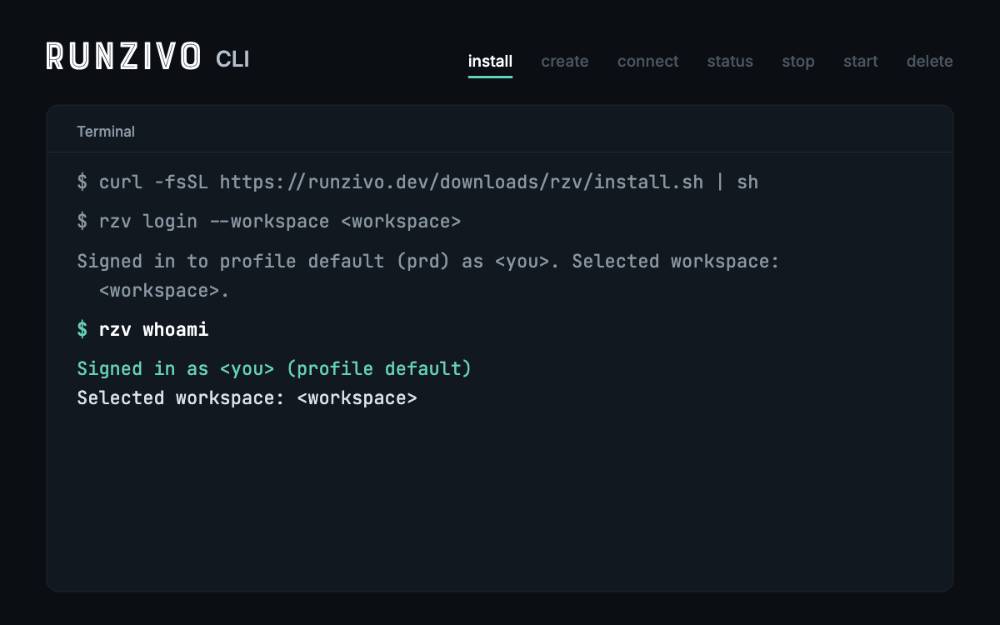

# rzv

`rzv` is the Runzivo command-line tool. It signs you in, lists your Runzivo workspaces and shows the status of your jobs.

[](https://github.com/Runzivo/rzv-cli/actions/workflows/ci.yml) [](https://github.com/Runzivo/rzv-cli/releases/latest) [](LICENSE)



This repository holds the source code of `rzv` (Go), its release notes and its releases. It is public so you can read the code you run; it does not accept outside contributions.

## Install

```sh
curl -fsSL https://runzivo.dev/downloads/rzv/install.sh | sh
```

The installer downloads the latest release, checks its SHA-256 checksum and puts `rzv` in `$RZV_INSTALL_DIR` (default `~/.local/bin`). `rzv` is one static executable. Sandbox SSH uses your installed OpenSSH client on macOS or Linux. The binary includes pinned `golang.org/x/crypto/ssh` for OpenSSH keys and certificates, plus its indirect `golang.org/x/sys` dependency. More options, platforms and manual downloads: [docs/install.md](docs/install.md).

## Use

```sh
rzv login                              # sign in through your browser
rzv login -p work -w acme              # a second profile, with a workspace selected
rzv profiles list                      # local profiles and which one is active
rzv whoami                             # who you are signed in as
rzv workspaces list                    # workspaces you belong to
rzv workspaces select <workspace>      # id, slug or display name
rzv jobs list                          # jobs for the selected workspace
rzv activity list                      # workspace activity log
rzv activity status                    # audit signals and execution evidence
rzv insights summary                   # workspace job metrics
rzv ai settings show                   # AI configuration for the selected workspace
rzv ai usage summary --group-by day    # workspace AI usage
rzv sandboxes list                     # sandboxes: create, exec, ssh, stop, delete
rzv sandboxes ssh-config <sandbox-id> --write  # standard SSH and Remote SSH editors
rzv logout                             # remove the stored sign-in
```

Add `--json` to any command for machine-readable output. `rzv` never prints your access token. Run `rzv help` for every command.

Runzivo is in Early Access. Sign in with your Runzivo account, then select a workspace you belong to. Runzivo runs jobs for repositories owned by GitHub organizations, including GitHub Free organizations. Personal repositories are unsupported. See the [CLI guide](https://runzivo.dev/docs/cli) and [getting started](https://runzivo.dev/docs/getting-started).

**Staff commands are not included.** Runzivo staff work stays in the staff console; `rzv` covers the customer API only.

## Documentation

- Start with the website's [CLI setup](https://runzivo.dev/docs/cli/), [sign-in guide](https://runzivo.dev/docs/sign-in/) and [Agent Sandboxes overview](https://runzivo.dev/sandboxes/). The guides here cover command arguments and tool-specific setup.
- [docs/README.md](docs/README.md): index of the guides below
- [Sign-in and credentials](docs/login.md)
- [Commands](docs/commands.md), [workspace commands](docs/workspace-commands.md), [support tickets](docs/tickets.md), [notifications](docs/notifications.md), and [AI settings and usage](docs/ai.md), and [sandboxes](docs/sandboxes.md)
- [Development](docs/development.md)

## Releases and changes

- [CHANGELOG.md](CHANGELOG.md) lists what changed in each release.
- The [website changelog](https://runzivo.dev/changelog) ([RSS](https://runzivo.dev/changelog/rss.xml)) covers the CLI and the Runzivo service.

## Help and security

- Product ideas and voting: [Runzivo community](COMMUNITY.md), covering all Runzivo products.
- Priorities and progress: [roadmap and voting guide](https://runzivo.dev/roadmap/) or the [public GitHub board](https://github.com/orgs/Runzivo/projects/3/views/1).

- Questions: support@runzivo.dev
- Security issues: see [SECURITY.md](SECURITY.md).

## License

Proprietary. See [LICENSE](LICENSE). Open-source components: [THIRD_PARTY_NOTICES.md](THIRD_PARTY_NOTICES.md).
